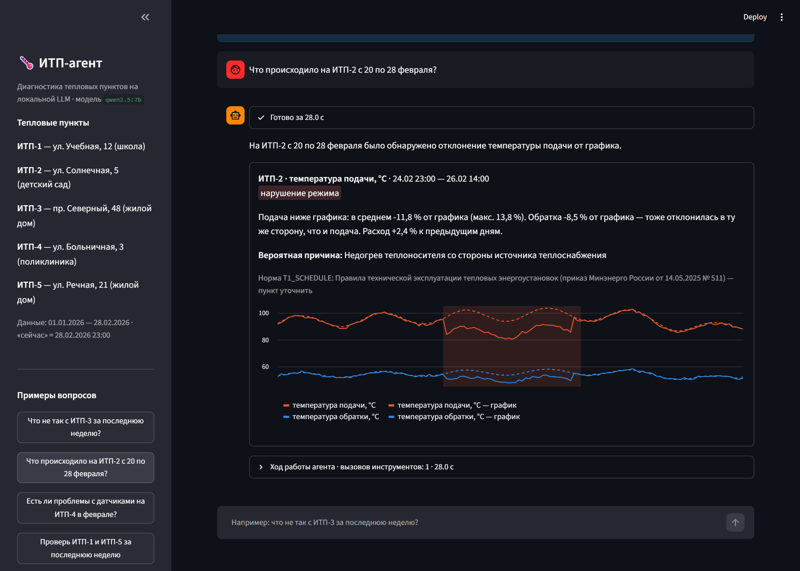
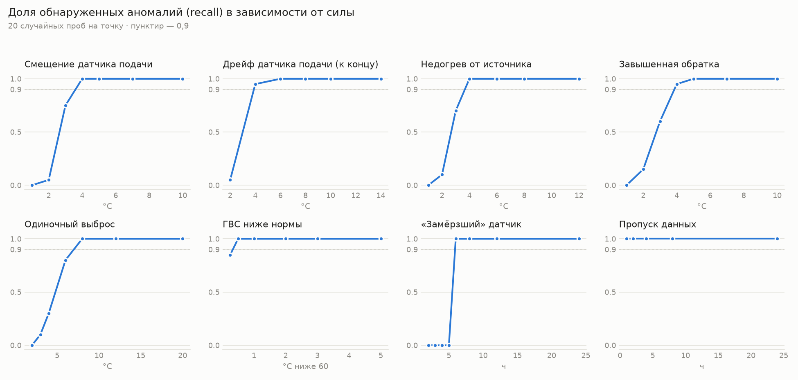
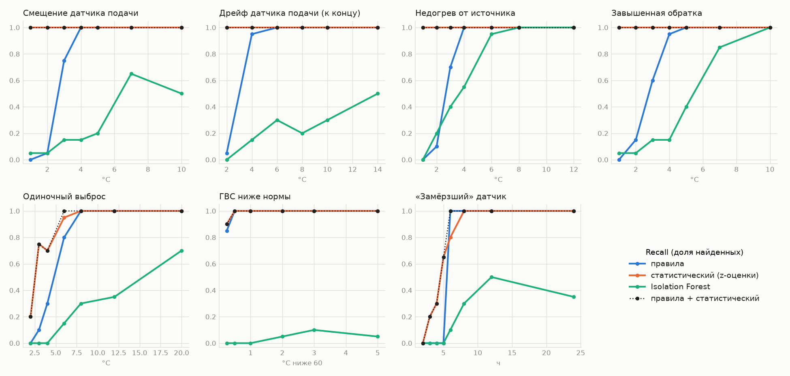
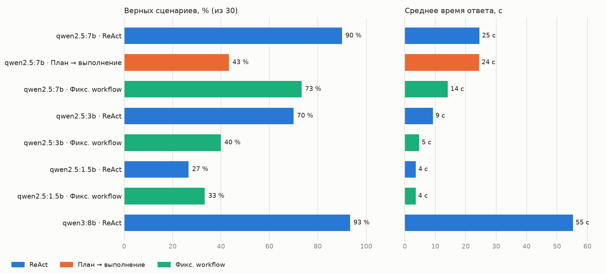
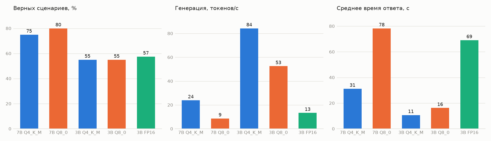
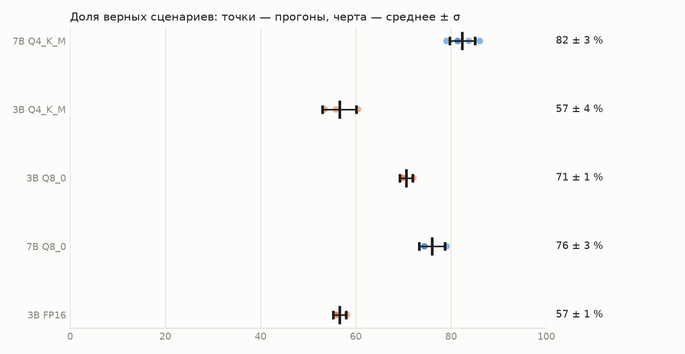
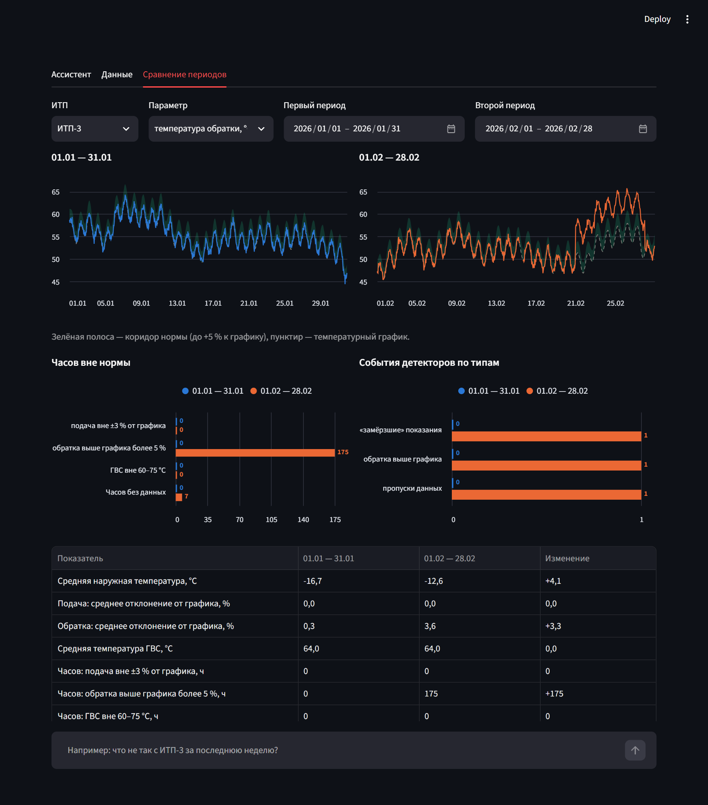
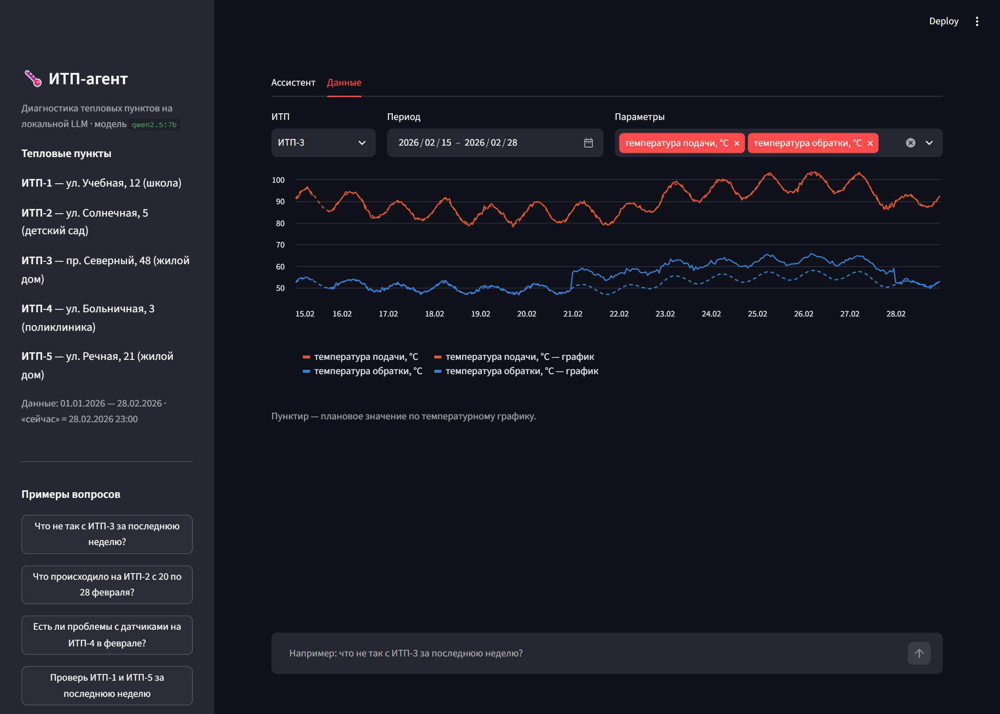

# ИТП-агент: диагностика тепловых пунктов на локальной LLM

[](https://github.com/lemjke/itp-agent/actions/workflows/tests.yml)

Прототип агентной системы, которая отвечает на вопросы инженера по эксплуатации
индивидуальных тепловых пунктов (ИТП): находит отклонения в данных датчиков, определяет
вероятную причину (неисправность датчика или нарушение режима) и ссылается на нарушенное
нормативное требование. Модель работает локально — данные не уходят во внешние API.

Основа выпускной квалификационной работы (НГТУ, 09.03.01 «Информатика и вычислительная техника», 2027).



## Что умеет

- Понимает вопрос в свободной форме: «что не так с ИТП-3 за последнюю неделю?», «проверь все пункты
  за три дня», «чо там с итп 2 10 февраля», «Any issues at substation 1 in January?» — сам выбирает ИТП и период.
- Понимает ИТП по адресу и жалобе: «жильцы дома на Северном жалуются на жару» → ИТП-3, завышенная обратка.
- Отвечает на вопросы о значениях: «какая средняя температура обратки на ИТП-3 в феврале?» → 53,8 °C.
- Находит пропуски данных, «замёрзшие» показания, выбросы, отклонения подачи и обратки
  от температурного графика, выход ГВС за 60–75 °C, падение перепада давлений.
- Отличает неисправность датчика от нарушения режима по поведению связанных параметров:
  сдвинулась только подача — датчик; подача и обратка просели вместе — недогрев от источника.
- Ссылается на норму из проверяемой таблицы требований, а не формулирует её сам.
- Отвечает на вопросы о нормах по тексту действующих документов: «сколько часов в месяц может не быть
  горячей воды?» → 8 часов, ПП № 354, приложение 1, п. 4 (поиск по смыслу, pgvector).
- Показывает ход работы: какие инструменты вызваны и что они вернули.
- Хранит историю диалогов в PostgreSQL (`itp/history.py`): диалог переживает обновление страницы
  (его id — в адресе, `?chat=…`), прошлые диалоги — в боковой панели. Под ответом — 👍/👎: каждая пара
  «вопрос → ответ» сохраняется целиком, с вызовами инструментов и моделью. Это журнал работы агента
  и источник реальных вопросов для новых сценариев оценки.
- Понимает уточнения в диалоге: «Есть ли проблемы на ИТП-4 в январе?» → «А в феврале?» — агент
  переписывает уточнение в самостоятельный вопрос и показывает, как его понял.
- Сравнивает два периода одного ИТП (вкладка «Сравнение периодов» и вопрос в чате «сравни январь
  и февраль на ИТП-3»): часы вне нормы, события, тепло с поправкой на погоду.
- Кроме проверки по нормам ищет несогласованность показаний статистикой (тепловой баланс и др.):
  видит смещение датчика на 1–2 °C, которое норма не ловит, и помечает его «требует проверки».
- На вопросы не по теме вежливо отказывает, а не сочиняет.

## Архитектура

```
вопрос ──► LLM (Qwen 2.5 7B через Ollama, локально)
              │  вызов инструментов
              ├─► list_substations   — какие ИТП и за какой период есть данные
              ├─► query_sensors      — посуточные сводки (шаблонные SQL, не свободный SQL)
              ├─► detect_anomalies   — детекторы → события с описанием, контекстом и нормой
              ├─► get_requirement    — текст нормы по коду
              └─► search_norms       — поиск пунктов в нормативных документах (bge-m3 + pgvector)
              ▼
         отчёт по JSON-схеме (structured output) ──► карточки с графиками / текст
```

Принципы:
- **LLM не считает числа и не формулирует нормы.** Вычисления — в детерминированных инструментах
  (pandas, PostgreSQL), нормы — в таблице, которую проверяет эксперт, и в текстах документов,
  которые агент находит поиском и пересказывает со ссылкой на пункт.
- **Роль LLM** — понять вопрос, выбрать ИТП и период, вызвать инструменты, сопоставить связанные
  параметры и сформулировать гипотезу о причине.
- **Ответ по JSON-схеме** — его можно автоматически сверять с эталоном.
- **Обвязка страхует маленькую модель** (`itp/agent.py`, `itp/grounding.py`):
  - каждая находка сверяется с событиями детекторов: без опоры — отбрасывается, даты и норма
    берутся из события, а не из текста модели;
  - если модель не вызвала ни одного инструмента, отчёт не строится (ему не на что опереться) —
    вместо выдуманных «ИТП №123» пользователь видит, с чем агент умеет помогать;
  - числа в ответе, которых нет в данных инструментов, подсвечиваются как непроверенные;
  - число из данных, приписанное не тому показателю («тепло на градусо-сутки −23 %», хотя −23 % —
    сырое тепло; «максимальная обратка 62,5 °C» — на деле посуточное среднее), тоже подсвечивается
    (`itp/attribution.py`): на 142 сохранённых ответах 7 срабатываний, все — настоящие подмены;
  - ошибки инструментов возвращаются с подсказкой («вероятно, ошибка в годе — повторите с …»),
    а если модель сдаётся после ошибки, цикл один раз просит исправить вызов;
  - шаблон вместо числа (`${period_summary…}`) — повторный запрос ответа;
  - сообщение о сокращении периода («данные есть только с …») доводится до пользователя всегда.

## Оценка качества

Эталон — разметка аномалий, внесённых генератором. Совпадение события: тот же ИТП и параметр,
пересечение по времени с допуском ±6 ч. Для вопросов о значениях эталонное число считается прямо
из БД, мимо инструментов агента.

30 сценариев диагностики в четырёх группах (плюс 10 вопросов о нормах — см. «Поиск по нормативным
документам»):
- **S, N** (16) — диагностика с разными формулировками периода и отрицательные сценарии без проблем;
- **A** (6) — нетипичные вопросы, найденные ручным «стресс-тестом»: значение вместо диагноза, адрес
  вместо номера, сравнение, жалоба жильцов, слишком длинный период, вопрос не по теме.
  На них агент дорабатывался;
- **H** (8) — **отложенный набор**: написан до прогона, агент на нём не настраивался —
  опечатки и разговорный стиль, английский, адреса, жалоба на холод, период за пределами данных.

| | v1 | v2 | v3 |
|---|---|---|---|
| Диагностика и отрицательные (S, N) | 13 / 16 | 16 / 16 | 16 / 16 |
| Нетипичные (A) | — | 2 / 6 ¹ | 5 / 6 |
| **Отложенный набор (H)** | — | — | **8 / 8** |
| Precision / Recall по событиям | 0,86 / 0,67 | 1,00 / 1,00 | 1,00 / 0,97 |
| Верная категория причины / ссылка на норму | 100 % / 100 % | 100 % / 100 % | 100 % / 100 % |
| Среднее время ответа | 23 с | 26 с | 26 с |

¹ ручной прогон шести вопросов на v2: верны ответы про сравнение двух ИТП и про школу на Учебной; про «анекдот» модель
выдумала «ИТП №123» и «Приказ №1234», на вопрос о средней температуре — несуществующий дрейф датчика.

Что менялось:
- **v1 → v2:** `substation="все"`, явные даты относительных периодов в промпте, ошибка периода
  с подсказкой исправленного года, enum параметров в JSON-схеме.
- **v2 → v3:** проверка находок по событиям детекторов, отказ без вызова инструментов, поле `answer`
  с прямым ответом, сводка за период в `query_sensors`, распознавание ИТП по адресу, периоды до 120 дней
  с сообщением о сокращении, события не обрезаются по границе периода.

Оставшаяся ошибка (A03, «у кого хуже с датчиками»): агент назвал только ИТП-4 и опустил событие на ИТП-1.

**Повторный прогон v3** (после смены порога выбросов и выделения архитектур в отдельные функции) — 27 / 30:
к A03 добавились H03 (на жалобу «в детском саду было холодно» модель не вызвала ни одного инструмента,
и сработал отказ как на вопрос не по теме) и A05 («за всю зиму»: модель сама взяла период с 1 января и
не сказала, что декабря в данных нет). Разброс между прогонами — около двух сценариев из 30, поэтому
разница меньше этого — не повод для выводов.

**v4 (с поиском по нормам)** — на тех же 30 сценариях 29 / 30 (снова только A03): новый инструмент
не сломал диагностику.

**v5 (сравнение периодов, подозрения статистики)** — полный регрессионный прогон 43 сценариев: 29 / 43.
Разбор показал две вещи:
- **вопросы о нормах упали до 1 / 10:** ответы по сути верные, но с выросшим промптом (новый инструмент
  и правило) 7B-модель перестала указывать источник — ни в тексте, ни в поле источников. Исправлено в коде,
  а не промптом: если поиск норм вызывался, а источника нет, он восстанавливается по числам ответа —
  берётся найденный пункт, в тексте которого есть эти числа; при ничьей или без совпадений источник
  не ставится (неверная ссылка хуже отсутствующей). Повторный прогон вопросов о нормах: 4 / 10;
- **диагностика:** S10, H05 и S03 в этом прогоне не вызвали нужный инструмент — те же сценарии в других
  прогонах проходили; это разброс между прогонами (см. «Квантизации»), а не регрессия кода: подозрения
  статистики на текущих данных пусты, и инструменты возвращают агенту то же, что раньше.

Подробно по сценариям: [eval/RESULTS.md](eval/RESULTS.md) (последний прогон, v4),
[первый прогон v3](eval/RESULTS_v3_first.md), [v2](eval/RESULTS_v2.md),
[v1](eval/RESULTS_v1_baseline.md); сырые ответы агента — `eval/results/*.json`.

**Ограничения оценки.** Данные синтетические, аномалий 11, сценарии писал один автор, прогон один
(temperature 0). Метрики проверяют факты (что найдено, категория, норма, числа), но не качество
формулировок: гипотеза о причине иногда звучит неточно при верной категории. Подсказки о типичной
причине частично заложены в описания событий детекторов — без них 7B-модель путала причины.
Дальше: оценка формулировок экспертом (каппа Коэна), реальные данные ИТП.

### Чувствительность детекторов

11 аномалий эталона заданы вручную и достаточно сильные, поэтому «11 из 11» мало что говорит о пределах
детекторов. Отдельный эксперимент (`python -m eval.eval_sensitivity`, ~30 с, без LLM): для каждого вида
аномалии и уровня силы — 20 случайных проб на новом синтетическом ряде (своя погода и шум), со случайным
местом и длительностью.



| Аномалия | Надёжно (recall ≥ 0,9) обнаруживается с | Почему так |
|---|---|---|
| Смещение / дрейф датчика подачи, недогрев | 4 °C | порог нормы ±3 % от графика ≈ 2,5–3 °C |
| Завышенная обратка | 4 °C | порог нормы +5 % ≈ 2,5–3 °C, среднесуточное окно |
| Одиночный выброс | 8 °C (6 °C — в 80 % случаев) | порог подобран по компромиссу ниже |
| ГВС ниже 60 °C | 0,5 °C ниже нормы | |
| «Замёрзший» датчик | 6 ч | порог детектора |
| Пропуск данных | 1 ч | |

Ложных срабатываний на 30 чистых рядах (42 480 ч) — ноль.

**Что из этого следует.** Смещение датчика меньше ~3 °C принципиально не видно детектору, который
сравнивает подачу с графиком: такое смещение неотличимо от допустимого отклонения режима. Для этого
нужна перекрёстная проверка датчиков — она сделана статистическим детектором (следующий раздел).

**Подбор порога выбросов.** Первый вариант (8 σ, не менее 4 °C) пропускал все выбросы до 6 °C.
Перебор порога на тех же пробах:

| Порог | Recall при 4 °C | при 6 °C | при 8 °C | Ложных выбросов на чистых рядах |
|---|---|---|---|---|
| 8 σ, ≥ 4 °C (было) | 0,00 | 0,00 | 0,40 | 0 |
| 5 σ, ≥ 3 °C | 0,10 | 0,60 | 0,75 | 0 |
| **4 σ, ≥ 2,5 °C (выбрано)** | 0,30 | 0,80 | 1,00 | 0 |
| 3 σ, ≥ 2 °C | 0,65 | 0,95 | 1,00 | 5 |

Выбран самый чувствительный порог без ложных срабатываний; эталон после смены порога — по-прежнему
11 из 11. Полные таблицы — [eval/SENSITIVITY.md](eval/SENSITIVITY.md).

### Статистические и ML-детекторы

Правила видят только то, что выходит за норму. Статистические детекторы (`itp/ml_detect.py`) ищут
другое — несогласованность показаний между собой и с обычным поведением этого ИТП. Признаки по часам:
отклонения подачи и обратки от графика, **тепловой баланс** (расход × (подача − обратка) на единицу
нагрузки по погоде — для ИТП он почти постоянен), ГВС, перепад давлений, скачки относительно соседних
часов, «застывание». Два детектора на одних признаках:

- **статистический** — устойчивые z-оценки (медиана и MAD ряда), у каждого признака свой порог;
- **Isolation Forest** — на тех же z-оценках.

Пороги подобраны на 20 отдельных чистых рядах (максимум с запасом 10 %, `itp/ml_thresholds.json`),
ложные срабатывания считались на других 30, чувствительность — на тех же случайных пробах, что у правил
(`python -m eval.eval_ml`, ~10 мин, без LLM). Попадание для всех — любое событие ±6 ч от аномалии.



| Аномалия | Правила | Статистический | Isolation Forest |
|---|---|---|---|
| Смещение датчика подачи | 4 °C | **1 °C** | не находит |
| Дрейф датчика | 4 °C | **2 °C** | не находит |
| Недогрев от источника / завышенная обратка | 4 °C | **1 °C** | 6–10 °C |
| Одиночный выброс | 8 °C | **6 °C** | не находит |
| ГВС ниже 60 °C | 0,5 °C | 0,25 °C | не находит |
| «Замёрзший» датчик | 6 ч | 8 ч | не находит |
| Ложных событий на 1000 ч чистых рядов | 0 | 0,19 | 0 |
| Эталон (11 аномалий) | 11, лишних 0 | 11, лишних 0 | 6 |

(уровень, с которого recall ≥ 0,9; полные таблицы — [eval/ML.md](eval/ML.md))

- **Смещение датчика на 1–2 °C** правила не видят принципиально, а тепловой баланс сдвигается на 12–21 σ:
  датчик подачи «показал» больше, а расход и обратка не изменились. Это и есть перекрёстная проверка
  датчиков, которой не хватало правилам.
- **Isolation Forest проиграл простой статистике.** Аномалия видна в одном-двух признаках из тринадцати,
  и в «лесе» по всем признакам она растворяется; чтобы не было ложных срабатываний, порог приходится
  ставить так высоко, что находятся только крупные аномалии. Для таких данных интерпретируемые z-оценки
  по признакам лучше «чёрного ящика» — и сразу объясняют, что не так.
- **Цена — 0,19 ложного события на 1000 ч** (примерно одно в 7 месяцев на ИТП), поэтому статистика
  не заменяет правила, а дополняет их: в ответе агента это отдельный блок «требует проверки» без нормы
  и категории, в находки (и проверку находок) он не попадает. На текущих данных все аномалии видят и
  правила, поэтому подозрений агент сейчас не показывает — они появятся на слабых отклонениях.
- **Ограничение:** синтетические данные построены на той же физике (расход из тепловой нагрузки),
  поэтому тепловой баланс в них почти идеален. В реальном ИТП его размывают теплопотери, нагрузка ГВС
  и погрешность приборов учёта — пороги придётся калибровать на реальных данных, и чувствительность
  будет ниже.
- Найдено и исправлено по ходу: ложное «застывание» на краю ряда (разброс по неполному окну) и одиночный
  час «застывания» как шум — событие только из признаков «застывания» теперь не короче 3 ч
  (цена: статистика ловит «замёрзший» датчик с 8 ч, правила — по-прежнему с 6).

### Сравнение архитектур и моделей

Те же 30 сценариев, те же инструменты, общая финальная стадия и все проверки — меняется только способ,
которым агент решает, что вызвать (`arch` в `itp/agent.py`), и модель:

- **ReAct** — модель сама выбирает следующий вызов, видя результаты предыдущих;
- **план → выполнение** — модель сразу выдаёт весь план вызовов (JSON-схема), код его выполняет;
- **фиксированный workflow** — модель только разбирает вопрос (что спрашивают, какие ИТП, период,
  параметр), вызовы делает код по жёсткой схеме.



| Архитектура · модель | Верно | Отложенный набор (H) | Recall по событиям | Отброшено проверкой | Время |
|---|---|---|---|---|---|
| ReAct · qwen2.5:7b | 27 / 30 | 7 / 8 | 0,94 | 0 | 25 с |
| План → выполнение · qwen2.5:7b | 13 / 30 | 3 / 8 | 0,35 | 1 | 24 с |
| Workflow · qwen2.5:7b | 22 / 30 | 6 / 8 | 0,65 | 1 | 14 с |
| ReAct · qwen2.5:3b | 21 / 30 | 5 / 8 | 0,61 | 6 | 9 с |
| Workflow · qwen2.5:3b | 12 / 30 | 3 / 8 | 0,26 | 9 | 5 с |
| ReAct · qwen2.5:1.5b | 8 / 30 | 3 / 8 | 0,03 | 1 | 4 с |
| Workflow · qwen2.5:1.5b | 10 / 30 | 3 / 8 | 0,26 | 5 | 4 с |
| ReAct · qwen3:8b | **28 / 30** | 7 / 8 | **1,00** | 0 | 55 с |

Precision у всех конфигураций 0,89–1,00: лишних находок почти нет, потому что их отсекает сверка
с детекторами. Ошибаются в основном пропусками — агент не вызвал нужный инструмент или вызвал его
не с теми аргументами. Полная таблица — [eval/COMPARISON.md](eval/COMPARISON.md).

**Что видно по ошибкам:**
- **План → выполнение проваливается на 7B.** В 14 из 17 неверных сценариев модель вернула пустой план:
  составить массив шагов по схеме разом ей сложнее, чем сделать один вызов. Без вызовов
  срабатывает отказ «вопрос не по теме». Ранние эксперименты с этой схемой ещё и зацикливали генерацию
  массива — понадобились лимиты на длину ответа.
- **Фиксированный workflow быстрее почти вдвое (14 с против 25 с), но теряет гибкость.** Модель
  ошибается в одном решении — тип вопроса — и исправить его нечем: «есть ли пропуски в январе»
  уходит в запрос значений, а не в детекторы. ReAct в той же ситуации видит результат и вызывает
  следующий инструмент.
- **Маленькие модели путают аргументы.** 3B часто вызывает `query_sensors` вместо `detect_anomalies`;
  1.5B подставляет период в `list_substations`, а в workflow пишет даты словами («в январе»).
  Сверка с детекторами здесь работает: у 3B она отбросила 6–9 находок без опоры на данные.
- **qwen3:8b — лучший результат, но в 2,2 раза медленнее** (режим размышлений отключён). Обе её
  ошибки — A05 и H05: сама сократила период до доступного и не сказала об этом пользователю.

**Вывод для прототипа:** ReAct на 7–8B. Workflow на 7B — запасной вариант, если важнее скорость;
модели меньше 7B для этой задачи не годятся. Квантизации не сравнивались — все модели в Q4_K_M из
Ollama; это следующий шаг. Один прогон на конфигурацию, разброс ±2 сценария (см. выше), поэтому
надёжны только крупные разрывы. Сравнение сделано до добавления поиска по нормам (v3, 30 сценариев).

### Квантизации

Та же оценка (40 сценариев, ReAct) для разной точности весов (`python -m eval.compare_quant`, ~3 ч),
плюс скорость генерации на одинаковом запросе и размещение модели. 7B в FP16 (15,2 ГБ) на ноутбуке
с 6 ГБ видеопамяти и 16 ГБ ОЗУ не помещается.



| Модель | Размер | В видеопамяти | Генерация | Верно из 40 | Время ответа |
|---|---|---|---|---|---|
| **7B Q4_K_M** | 5,4 ГБ | 76 % | **24 ток/с** | 30 | **31 с** |
| 7B Q8_0 | 8,8 ГБ | 48 % | 9 ток/с | 32 | 78 с |
| 3B Q4_K_M | 2,4 ГБ | 100 % | 84 ток/с | 22 | 11 с |
| 3B Q8_0 | 3,7 ГБ | 100 % | 53 ток/с | 22 | 16 с |
| 3B FP16 | 7,2 ГБ | 57 % | 13 ток/с | 23 | 69 с |

- **Размер модели важнее точности весов.** 7B — 30–32 из 40 в любой квантизации, 3B — 22–23. Разница
  между квантизациями одного размера (1–2 сценария) — в пределах разброса между прогонами: та же 7B Q4
  на том же коде дала 35 из 40 накануне и 30 в этом прогоне (см. ниже).
- **Скорость решает то, помещается ли модель в видеопамять.** 7B Q8 и 3B FP16 не помещаются в 6 ГБ:
  половина слоёв считается на процессоре, генерация падает в 3–6 раз, ответ — с 31 до 69–78 с. 3B FP16
  получилась медленнее 7B Q4 при заметно худшем качестве.
- **Вывод:** 7B Q4_K_M — лучшее качество на секунду ответа для GPU 6 ГБ. Более высокая точность имеет
  смысл, только если модель целиком помещается в видеопамять.
- **Разброс между прогонами.** Даже при temperature 0 Ollama не полностью детерминирована (разбиение
  запроса на пакеты, кэш предыдущего запроса), и 7B-модели этого хватает, чтобы иногда выбрать другой
  инструмент: в разных прогонах одни и те же вопросы «Горячая вода 55 градусов — это нарушение?» уходили
  то в поиск норм, то в детекторы. Одного прогона мало для различий в 1–3 сценария — дальше нужны
  3–5 прогонов на конфигурацию со средним и разбросом. Полная таблица — [eval/QUANTIZATION.md](eval/QUANTIZATION.md).

### Повторные прогоны: среднее и разброс

Те же 43 сценария, 7B Q4 — 5 прогонов, остальные конфигурации — по 3 (`python -m eval.repeat_runs`).

| Конфигурация | Верно из 43 (среднее ± σ) | Мин–макс | Ответ |
|---|---|---|---|
| **7B Q4_K_M** | **35,4 ± 1,1** | 34–37 | 32 с |
| 7B Q8_0 | 32,7 ± 1,2 | 32–34 | 94 с |
| 3B Q8_0 | 30,3 ± 0,6 | 30–31 | 31 с |
| 3B Q4_K_M | 24,3 ± 1,5 | 23–26 | 15 с |
| 3B FP16 | 24,3 ± 0,6 | 24–25 | 141 с |



- **Разброс — около ±1 сценария**, поэтому различия в 2–3 сценария между конфигурациями уже не шум.
- **7B Q8 не лучше Q4**: на 3 сценария меньше и втрое медленнее (не помещается в 6 ГБ) — выбор Q4 подтверждён.
- **У 3B квантизация заметна**: Q8 стабильно лучше Q4 (30 против 24), а FP16 — на уровне Q4 и в 9 раз медленнее.
- **Нестабильные сценарии 7B Q4** (проходят не во всех прогонах): «вся зима» (A05), ремонт ГВС (R04),
  сравнение январь/февраль (C01), обратка +4 % (R03), H10; не проходят ни разу — A03, H05, R01.
  Слабее всего нормы: 2,8 ± 0,4 из 6. Подробно — [eval/REPEATS.md](eval/REPEATS.md).

### Правки по нестабильным сценариям

Чтобы не подгонять агента под известные вопросы, **до правок** написаны 8 новых сценариев V01–V08
на те же слабые места (вся зима, период через Новый год, сравнение двух ИТП, сравнение месяцев по адресу,
нормы на давление, аварию и ГВС) и прогнаны на старом коде: 3 / 8 во всех трёх прогонах. Затем — правки
и по 3 контрольных прогона всех 51 сценария (`python -m eval.compare_fixes` → [eval/FIXES.md](eval/FIXES.md)).

| 7B Q4, среднее ± σ | До | После |
|---|---|---|
| 43 старых сценария (на них искали слабые места) | 35,4 ± 1,1 | **40,7 ± 0,6** |
| **8 новых V (написаны до правок)** | **3,0 ± 0,0** | **8,0 ± 0,0** |
| Нормы, из 6 | 2,8 ± 0,4 | 5,0 ± 0,0 |

Рост на старых сценариях (+5 при σ ≈ 1) — не шум, но на них и искали слабые места; главный довод —
новые V: 3 → 8 из 8 во всех прогонах.

Что поменялось:
- **выбор инструмента:** проверка за длинный период («с декабря по февраль», «за всю зиму») — это
  `detect_anomalies`, а не сравнение; сравнение двух ИТП — детекторы по каждому. `compare_periods`
  отклоняет пересекающиеся периоды и `substation="все"` с подсказкой, какой инструмент нужен;
- **месяцы:** явные даты для «декабря» и «зимы» (предыдущий год); период передаётся как спросили —
  инструмент сам сокращает его и сообщает об этом;
- **нормы:** поиск идёт и по запросу модели, и по исходному вопросу пользователя (модель переформулирует
  его хуже: «давление в подающих» → «давление»); источник восстанавливается по ссылке в тексте ответа
  («приказ № 511, п. 127»); если источника всё равно нет — один повторный запрос; если ответ сослался
  на пункт, но не назвал значение («ниже минимума» без 60 °C), добавляется фраза пункта;
- **сравнение периодов:** если модель не пересказала главное изменение (часы вне нормы), оно добавляется
  готовым текстом инструмента; проверка атрибуции чисел идёт до этого, по тексту модели;
- **находки:** если время сдвинуто (модель назвала «27.01 21:00» вместо «28.01 09:00»), но у этого ИТП
  и параметра событие одно — находка привязывается к нему, а в ответ добавляется время по данным;
- вопрос о тепловом пункте или о нормах без вызова инструментов — один раз просим ответить через
  инструменты (раньше на «что по правилам должно быть сделано в тепловом пункте…» срабатывал отказ
  «вне темы»: регулярка ждала «тепловы…» и не узнавала «тепловом пункте»).

Правки шли в три раунда, после каждого — 3 контрольных прогона. Первый раунд дал две регрессии
(S13 и R02 — 0 из 3 при 100 % до), второй закрыл их, третий — R06; все раунды видны в FIXES.md.

**Что не исправлено** — ограничения 7B-модели, а не обвязки:
- A03 («у кого хуже с датчиками»): из двух событий на ИТП-1 и ИТП-4 модель называет одно;
- R04 (ремонт ГВС): модель отвечает «8 часов» — это норма для аварии; верный пункт найден, но модель
  берёт число из соседней строки;
- C01 — разброс (2 из 3): в одном прогоне −4 % приписаны не тому показателю — это ловит проверка
  атрибуции, и сценарий засчитывается как ошибка;
- при исправленном времени находки в тексте ответа остаётся время, названное моделью, — верное
  добавляется отдельной строкой.

V01–V08 после первого прогона уже не «чистые»: при следующих правках нужен новый отложенный набор.

### Поиск по нормативным документам (RAG)

Раньше агент знал только 6 норм из таблицы, написанной вручную. Теперь у него есть инструмент `search_norms`:
поиск по смыслу в четырёх действующих документах (список — в разделе «Данные»), ~1,2 млн знаков.

```
docs/norms/*.txt ──► нарезка по пунктам ──► bge-m3 (Ollama) ──► PostgreSQL + pgvector (HNSW, косинус)
вопрос ──► LLM формулирует запрос ──► 5 ближайших пунктов ──► ответ по их тексту + источник
```

**Как оценивался поиск** (`python -m eval.eval_retrieval`): 23 вопроса словами инженера или жильца
(«обратка выше графика — это нарушение?») с эталонным пунктом, проставленным вручную по текстам.

| Нарезка | Поиск | Recall@1 | Recall@3 | Recall@5 | MRR |
|---|---|---|---|---|---|
| **по пунктам документа** | **векторный** | **0,78** | **0,96** | **0,96** | **0,86** |
| по пунктам | полнотекстовый (PostgreSQL, русская морфология) | 0,09 | 0,13 | 0,13 | 0,10 |
| по пунктам | гибридный (RRF) | 0,35 | 0,61 | 0,70 | 0,51 |
| окна по 1000 знаков | векторный | 0,57 | 0,87 | 0,87 | 0,72 |
| окна по 1000 знаков | гибридный (RRF) | 0,39 | 0,65 | 0,78 | 0,55 |

- **Нарезка по пунктам лучше окон** (Recall@1 0,78 против 0,57): пункт — смысловая единица нормы,
  а окно режет её посередине и смешивает с соседними. Для нарезки пришлось разобрать структуру документов:
  в ПП № 354 номера пунктов повторяются в правилах и пяти приложениях, без учёта раздела ссылка
  «п. 5» неоднозначна.
- **Полнотекстовый поиск почти бесполезен, и гибридный из-за него хуже чистого векторного.** Вопросы
  пишут своими словами — «подача», «обратка», «в кране», — а в документах «подающий трубопровод»,
  «обратные трубопроводы», «в местах водоразбора». Совпадают только общие слова, и наверх поднимаются длинные
  пункты, где их больше всего. Это отрицательный результат, но полезный: гибридный поиск — не
  универсальное улучшение, его надо проверять на своих данных.
- 23 вопроса — мало для тонких различий; надёжны только крупные разрывы.

**Как оценивался агент** — 10 вопросов о нормах в общей оценке: поиск вернул эталонный пункт, в ответе
есть его числа, нет чисел соседней нормы, есть ссылка на документ.

| | Первый прогон | После доработки |
|---|---|---|
| R01–R06 (на них дорабатывался агент) | 1 / 6 ² | 4 / 6 |
| **H09–H12 (отложенные, написаны до доработки)** | — | **2 / 4** |

² по нынешним критериям. Первая версия проверки засчитала 2 / 6: она не ловила подмену соседней нормой
в R04 — после этого добавлена проверка «чужих» чисел.

Что нашёл первый прогон и что исправлено:
- модель брала 3 пункта, а её короткий запрос ставил нужный п. 127 на 4-е место — ответила по соседнему
  п. 128 («5 %» вместо «3 %»). Теперь берётся 5 пунктов;
- модель дословно копировала пример запроса из описания инструмента — пример убран;
- на «горячая вода 55 градусов — это нарушение?» вызывала детекторы вместо поиска норм — добавлено
  правило выбора инструмента (примеры в нём — на другие параметры, чтобы не подгонять под тест);
- источники стали отдельным полем ответа и сверяются с тем, что реально вернул поиск
  (`itp/grounding.py`): выдуманный «Приказ № 1234, п. 4» или пункт, которого не было в выдаче, отбрасывается;
- ответ на вопрос о норме ускорен с 30–50 до 12–26 с (длинный перечень работ — до 70 с): на GPU 6 ГБ
  модель эмбеддингов вытесняла LLM, и каждая смена моделей стоила 4–8 с. Эмбеддинг запроса теперь
  считается на CPU за 0,05 с.

Что осталось:
- **выбор инструмента** (H10): «сколько часов может не быть отопления?» агент принял за вопрос о данных
  и ответил «175 часов на ИТП-4» — про пропуск данных, а не про норму;
- **чтение таблиц** (R04): в приложении 1 к ПП № 354 в одной ячейке и лимит обычных перерывов ГВС (8 ч в месяц),
  и отсылка к санитарным правилам для плановых ремонтов — модель назвала 8 ч для ремонта;
- **ссылка на источник** (R06, H11): ответ верный, но модель не заполнила поле источников.

Эти ошибки — в отложенном наборе тоже, поэтому дальше их исправлять только с новым отложенным набором.
Следующие шаги: переписывание запроса перед поиском (запрос модели бывает короче и беднее вопроса),
переранжирование найденных пунктов, разбор таблиц в отдельные фрагменты по столбцам.

### Контекст диалога: уточняющие вопросы

Без контекста каждый вопрос обрабатывается с нуля, и «А за январь?» агенту непонятно. Сравнивались
три способа (`context` в `itp/agent.ask`, оценка — `python -m eval.eval_dialog`, ~45 мин):

- **без контекста** — база для сравнения;
- **история в сообщениях** — три предыдущие пары «вопрос → ответ» идут модели как часть переписки;
- **переписывание** — отдельный короткий запрос к модели превращает уточнение в самостоятельный вопрос
  («Что не так с ИТП-3 в январе?»), дальше агент работает как обычно, со всеми проверками.

16 диалогов (`eval/dialogs.py`): уточнение периода, ИТП, статистики, «подробнее про…», цепочка из трёх
вопросов, а также самостоятельные вопросы после диалога — история не должна их исказить.
Предыдущие вопросы задаются агенту по-настоящему, их ответы попадают в историю.

| Способ | Первый прогон, D01–D10 | После доработки, D01–D10 | **Отложенные D11–D16** | Время уточнения |
|---|---|---|---|---|
| без контекста | 5 / 10 | 5 / 10 | **3 / 6** | 36 с |
| история в сообщениях | 3 / 10 | 3 / 10 | **2 / 6** | 8 с |
| **переписывание** | 6 / 10 | 8 / 10 | **6 / 6** | 36 с |

Отдельная проверка: 40 самостоятельных вопросов основной оценки с чужой историей не должны меняться.
Переписывание изменило 6 из 40 в первом прогоне, 3 — во втором, 1 — после последней правки.

**История в сообщениях хуже, чем ничего.** Видя предыдущие ответы, 7B-модель отвечает «по памяти» и не
вызывает инструменты — тогда срабатывает защита «без данных не отвечаю», и пользователь получает отказ.
Отсюда и 8 с: инструменты не вызываются.

**Что пришлось исправить в переписывании после первого прогона** (D01–D10 после этого — не отложенные,
поэтому написаны D11–D16):
- модель переносила в вопрос содержимое предыдущих ответов — даты («с 21 по 27 февраля» вместо
  «за последнюю неделю»), проценты и даже сам ответ. Теперь она видит только предыдущие вопросы;
- модель меняла вид вопроса: «А на ИТП-4 за тот же период?» → «Какие параметры были…» вместо проверки.
  В инструкцию добавлено «сохрани слова и вид вопроса», в примеры — образцы такой правки (на других ИТП
  и периодах, чем в сценариях);
- на просьбу «верни без изменений» 7B-модель всё равно дописывала к вопросу ИТП из истории. Теперь модель
  сначала отдельным полем отвечает, ссылается ли вопрос на историю, а «не трогать» решает код по этому
  полю. Плюс проверка кодом до модели: если в вопросе названы ИТП и период и нет «тот же», вопрос
  самостоятельный и к модели не попадает. Последняя правка этой проверки (английские месяцы,
  разговорное «там» при названном ИТП) проверена на 40 самостоятельных вопросах, полный прогон
  диалогов после неё не повторялся.

Что осталось:
- **цепочка из трёх вопросов** (D07): «Проверь ИТП-4 в феврале» → «А ИТП-1?» → «А в январе?» понято как
  «Проверь ИТП-4 и ИТП-1 в январе» — модель не уловила, что второй вопрос заменил ИТП, а не добавил;
- **D03** — вопрос переписан верно («максимальная температура обратки на ИТП-3 в феврале»), но агент взял
  максимум из посуточных средних (62,5 °C) вместо часового максимума из сводки (65,8 °C) — это ошибка
  чтения ответа инструмента, не контекста;
- переписывание — ещё один запрос к модели (~1–2 с); на самостоятельных вопросах с ИТП и периодом
  его нет.

### Сравнение периодов

«Как этот месяц выглядит на фоне прошлого» — вкладка «Сравнение периодов» и инструмент агента
`compare_periods` (`itp/compare.py`). Два графика на одной шкале с коридором нормы, ниже — парные столбцы
«часы вне нормы» и «события по типам», таблица показателей с изменением.



- Часы вне нормы считаются тем же сглаживанием и по тем же порогам, что у детекторов — цифры
  не расходятся с найденными событиями.
- **Тепло сравнивается на градусо-сутки.** Сырое тепло на ИТП-3 в феврале на 23 % меньше январского,
  но февраль на 4 °C теплее: на градусо-сутки разница всего 4 %. Без поправки на погоду «экономию»
  дал бы любой тёплый месяц.
- В оценку агента добавлены сценарии C01–C03 («сравни январь и февраль на ИТП-3», «стало ли на ИТП-1
  лучше», «первая и вторая половина февраля на поликлинике»): засчитывается верный вызов с нужными
  периодами, главное изменение в ответе и отсутствие чисел, которых нет в данных.
- Первые прогоны — 1–2 из 3: из дюжины показателей 7B-модель выбирала не главное (C01 — только наружная
  температура) или переставляла числа между показателями («тепло на градусо-сутки −125 Гкал» — поймано
  проверкой непроверенных чисел). Теперь инструмент сам отдаёт `highlights` — главные изменения готовыми
  фразами по порядку важности, модель их пересказывает: 2 из 3 (C02 отвечает одной фразой «стало хуже»).
- Число, взятое из данных, но приписанное не тому показателю (сырое −23 % названо «на градусо-сутки»),
  проверка непроверенных чисел не ловит. Для этого сделана сверка «показатель — число»
  (`itp/attribution.py`): ответ режется на фразы, по словам определяется показатель, и числа фразы
  сверяются с числами именно этого показателя; для значений датчиков число привязывается к ближайшим
  перед ним параметру и статистике («средняя подача 98,3, обратка 54,3»). Неоднозначные фразы
  не проверяются — ложная тревога хуже пропуска. Отлажена на 142 сохранённых ответах: сначала было
  8 срабатываний с ложными (номера ИТП и годы как числа, ответы-списки), после правок — 7, все настоящие:
  подмены в C01, C02, H05 и D03. Сравнение периодов теперь засчитывается только без таких подмен.

## Данные

Синтетический генератор (`data/generate.py`) — 5 ИТП, январь–февраль 2026, часовые измерения:
наружная температура, подача/обратка по упрощённому температурному графику 130/70,
ГВС, давления, расход. Внесены 11 аномалий с эталонной разметкой (таблица `anomalies_truth`):

| Неисправности измерений | Нарушения режима |
|---|---|
| смещение датчика, дрейф, выброс, «замёрзшее» значение, пропуск | недогрев от источника, завышенная обратка, ГВС ниже 60 °C |



> Температурный график и климатические параметры упрощены. Нормы по подаче, обратке и ГВС сверены
> с действующими документами (`itp/norms.py`), правила по давлению и качеству данных — демонстрационные.
> В реальной системе — утверждённый график теплоснабжающей организации и таблица норм,
> проверенная экспертом-теплотехником.

**Нормативные документы** (`docs/norms/`, собираются `data/norms_corpus.py` с legalacts.ru — официальные
тексты актов не охраняются авторским правом, п. 6 ст. 1259 ГК РФ):

| Документ | Для чего |
|---|---|
| Правила технической эксплуатации объектов теплоснабжения и теплопотребляющих установок (приказ Минэнерго № 511 от 14.05.2025, действуют с 01.09.2025 вместо правил 2003 г.) | отклонения от температурного графика, эксплуатация тепловых пунктов |
| Правила предоставления коммунальных услуг (ПП РФ № 354) | допустимые перерывы и отклонения ГВС и отопления, температура в квартирах |
| Правила коммерческого учёта тепловой энергии (ПП РФ № 1034) | нештатные ситуации и неисправности узла учёта |
| СанПиН 2.1.3684-21 | температура горячей воды 60–75 °C |

## Запуск

### Docker Compose

Нужны Docker и [Ollama](https://ollama.com) с моделями `qwen2.5:7b` и `bge-m3` (`ollama pull …`).
База с pgvector, данные, индекс норм, веб-интерфейс и API поднимаются одной командой:

```bash
docker compose up --build
```

Веб-интерфейс — http://localhost:8501, API — http://localhost:8000/docs. При первом запуске сервис `init`
генерирует данные и строит индекс норм (~1,5 мин на GPU), при следующих — пропускает.
На сервере с NVIDIA GPU LLM тоже можно запустить в контейнере (модели скачаются при первом запуске):

```bash
OLLAMA_HOST=http://ollama:11434 docker compose --profile ollama up --build
```

### REST API

```bash
.venv\Scripts\uvicorn api:app --port 8000          # документация: http://localhost:8000/docs
```

| Метод | Что делает |
|---|---|
| `POST /ask` | вопрос агенту; `chat_id` — продолжить диалог («а за январь?») |
| `GET /chats`, `GET /chats/{id}` | история диалогов |
| `POST /messages/{id}/feedback` | оценка ответа: 1 — 👍, 0 — 👎 |
| `GET /health` | доступны ли БД, Ollama и модели |

### Тесты

`python -m pytest` — 47 тестов без LLM, ~4 с: детекторы (эталон 11 из 11, ноль событий на чистых рядах),
проверки ответа модели (находки, источники, числа), разбор вопроса и периодов, нарезка норм,
API с подменённым агентом. Тестам с меткой `db` нужна БД с данными, без неё они пропускаются.
На каждый push GitHub Actions поднимает PostgreSQL с pgvector, генерирует данные и прогоняет тесты
(пропускать тесты с БД там запрещено — `REQUIRE_DB`), а также собирает Docker-образ.
Качество ответов LLM этими тестами не проверяется — это делает `eval/` (нужна модель, десятки минут).

### Без Docker

Нужны Python 3.11+, PostgreSQL с расширением [pgvector](https://github.com/pgvector/pgvector)
и [Ollama](https://ollama.com). Хватает ноутбука с GPU на 6 ГБ.

```bash
ollama pull qwen2.5:7b
ollama pull bge-m3                                                     # эмбеддинги для поиска норм
python -m venv .venv
.venv\Scripts\pip install -r requirements-dev.txt
.venv\Scripts\python -m data.generate                                  # БД itp_db + данные
.venv\Scripts\python -m data.norms_index                               # индекс норм в pgvector (~1,5 мин)
.venv\Scripts\streamlit run app.py                                     # веб-интерфейс (или run_app.bat)
.venv\Scripts\python cli.py "Что не так с ИТП-3 за последнюю неделю?"   # командная строка
.venv\Scripts\python -m eval.eval_detectors                            # оценка детекторов
.venv\Scripts\python -m eval.eval_agent                                # оценка агента (~15 мин)
.venv\Scripts\python -m eval.eval_retrieval                            # оценка поиска норм (~1 мин)
.venv\Scripts\python -m eval.eval_dialog                               # контекст диалога (~45 мин)
.venv\Scripts\python -m eval.eval_sensitivity                          # чувствительность детекторов (~30 с)
.venv\Scripts\python -m eval.compare                                   # сравнение архитектур (~1,5 ч)
```

Пароль PostgreSQL — в переменной `PGPASSWORD` или в файле `itp/local_config.py` (`DB_PASSWORD = "..."`,
не коммитится). Строка подключения и модель переопределяются через `ITP_DB_DSN`, `ITP_LLM_MODEL`
(см. `itp/config.py`).

pgvector на Linux ставится пакетом (`apt install postgresql-18-pgvector`). На Windows его собирают из исходников
в «x64 Native Tools Command Prompt» Visual Studio:

```bash
git clone --branch v0.8.7 https://github.com/pgvector/pgvector.git
cd pgvector
set "PGROOT=C:\Program Files\PostgreSQL\18"
nmake /F Makefile.win
nmake /F Makefile.win install
```

Последняя команда — в окне, запущенном от имени администратора (копирует файлы в каталог PostgreSQL).

## Структура

```
itp/
  agent.py     агентный цикл, промпт, схемы инструментов и отчёта, проверки ответа
  grounding.py сверка находок с событиями детекторов
  tools.py     инструменты и детекторы
  norms.py     таблица нормативных требований
  rag.py       поиск по нормативным документам (pgvector, полнотекстовый, гибридный)
  history.py   история диалогов и оценки ответов
  ml_detect.py статистические и ML-детекторы (тепловой баланс, z-оценки, Isolation Forest)
  compare.py   сравнение двух периодов
  schedule.py  температурный график
  charts.py    графики для интерфейса
data/generate.py      генератор синтетических данных с аномалиями
data/norms_corpus.py  сбор текстов нормативных документов → docs/norms/
data/norms_index.py   нарезка, эмбеддинги, таблица norm_chunks
data/bootstrap.py     подготовка БД при первом запуске (Docker)
eval/              сценарии и оценка LLM: агент, поиск норм, диалоги, чувствительность, сравнение архитектур
tests/             быстрые тесты без LLM (pytest), запускаются в CI
app.py             веб-интерфейс (Streamlit)
api.py             REST API (FastAPI)
cli.py             командная строка
run_app.bat        запуск веб-интерфейса двойным кликом (Windows)
Dockerfile, compose.yaml           контейнеры: БД, подготовка данных, интерфейс, API, Ollama (профиль)
.github/workflows/tests.yml        CI: тесты с PostgreSQL + pgvector, сборка образа
```

## Дальше

- [x] отложенный набор сценариев
- [x] случайно генерируемые аномалии разной силы (чувствительность детекторов)
- [x] сравнение архитектур (ReAct / план→выполнение / фиксированный workflow) и размеров моделей
- [x] поиск по нормативным документам (RAG на pgvector) с оценкой поиска
- [x] история диалогов и оценка ответов 👍/👎
- [x] контекст диалога: уточняющие вопросы («а за январь?») с учётом предыдущих
- [x] REST API (FastAPI), тесты без LLM, CI на GitHub Actions, Docker Compose
- [x] сравнение квантизаций (Q4 / Q8 / FP16)
- [x] повторные прогоны оценки (3–5 на конфигурацию) со средним и разбросом
- [x] правки нестабильных сценариев с проверкой на новом наборе, написанном до правок
- [x] статистические и ML-детекторы (Isolation Forest) в дополнение к правилам
- [x] сравнение двух периодов (вкладка и инструмент агента)
- [ ] реальные данные ИТП

---

Сделано с помощью Claude Code: постановка задач, архитектурные решения, проверка результатов
и разбор ошибок агента — мои, код писал агент под моим руководством.
