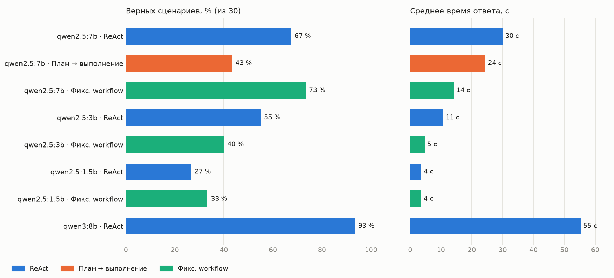

# Сравнение архитектур и моделей

Один и тот же набор из 30 сценариев (`eval/scenarios.py`), одни и те же инструменты, финальная стадия отчёта и проверки (grounding, отказ без вызова инструментов). Меняется только то, как агент решает, какие инструменты вызвать, и какая модель работает. temperature 0, один прогон на конфигурацию, ноутбук с RTX 4050 (6 ГБ).

- **ReAct** — модель сама выбирает следующий вызов по результатам предыдущих
- **План → выполнение** — модель сразу составляет весь план вызовов, обвязка его выполняет
- **Фикс. workflow** — модель только разбирает вопрос, вызовы делает код

| Архитектура | Модель | Всего верно | S+N | A | H (отложенный) | Precision / Recall | Категория | Числа | Вне темы | Отброшено проверкой | Время, с |
|---|---|---|---|---|---|---|---|---|---|---|---|
| ReAct | `qwen2.5:7b` | **29/43** | 14/16 | 5/6 | 8/12 | 1,00 / 0,77 | 100 % | 2/2 | 2/2 | 4 | 30 |
| План → выполнение | `qwen2.5:7b` | **13/30** | 7/16 | 3/6 | 3/8 | 1,00 / 0,35 | 100 % | 1/2 | 2/2 | 1 | 24 |
| Фикс. workflow | `qwen2.5:7b` | **22/30** | 12/16 | 4/6 | 6/8 | 0,95 / 0,65 | 100 % | 2/2 | 2/2 | 1 | 14 |
| ReAct | `qwen2.5:3b` | **22/40** | 12/16 | 4/6 | 5/12 | 1,00 / 0,65 | 95 % | 2/2 | 2/2 | 12 | 11 |
| Фикс. workflow | `qwen2.5:3b` | **12/30** | 6/16 | 3/6 | 3/8 | 1,00 / 0,26 | 75 % | 1/2 | 1/2 | 9 | 5 |
| ReAct | `qwen2.5:1.5b` | **8/30** | 4/16 | 1/6 | 3/8 | 1,00 / 0,03 | 100 % | 1/2 | 2/2 | 1 | 4 |
| Фикс. workflow | `qwen2.5:1.5b` | **10/30** | 4/16 | 3/6 | 3/8 | 0,89 / 0,26 | 62 % | 0/2 | 2/2 | 5 | 4 |
| ReAct | `qwen3:8b` | **28/30** | 16/16 | 5/6 | 7/8 | 1,00 / 1,00 | 100 % | 2/2 | 2/2 | 0 | 55 |

