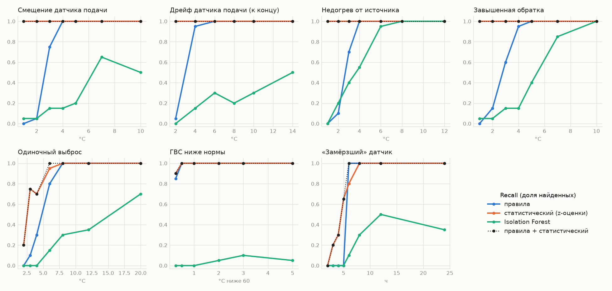

# Статистические и ML-детекторы против правил

Пороги — по 20 отдельным чистым рядам (`itp/ml_thresholds.json`). Попадание — любое событие, пересекающее аномалию ±6 ч, для всех детекторов одинаково. 20 проб на уровень.

## Надёжно (recall ≥ 0,9) обнаруживается с уровня

| Аномалия | правила | статистический (z-оценки) | Isolation Forest | правила + статистический |
|---|---|---|---|---|
| Смещение датчика подачи | 4 °C | 1 °C | — | 1 °C |
| Дрейф датчика подачи (к концу) | 4 °C | 2 °C | — | 2 °C |
| Недогрев от источника | 4 °C | 1 °C | 6 °C | 1 °C |
| Завышенная обратка | 4 °C | 1 °C | 10 °C | 1 °C |
| Одиночный выброс | 8 °C | 6 °C | — | 6 °C |
| ГВС ниже нормы | 0,5 °C ниже 60 | 0,25 °C ниже 60 | — | 0,25 °C ниже 60 |
| «Замёрзший» датчик | 6 ч | 8 ч | — | 6 ч |

## Ложные срабатывания на 30 чистых рядах (42480 ч)

| Детектор | Событий на 1000 ч |
|---|---|
| правила | 0,00 |
| статистический (z-оценки) | 0,19 |
| Isolation Forest | 0,00 |
| правила + статистический | 0,19 |

## Эталон из БД (11 внесённых аномалий)

| Детектор | Найдено | Лишних событий |
|---|---|---|
| правила | 11 / 11 | 0 |
| статистический (z-оценки) | 11 / 11 | 0 |
| Isolation Forest | 6 / 11 | 0 |
| правила + статистический | 11 / 11 | 0 |

## Recall по уровням

| Аномалия | Сила | правила | статистический (z-оценки) | Isolation Forest | правила + статистический |
|---|---|---|---|---|---|
| Смещение датчика подачи | 1 °C | 0,00 | 1,00 | 0,05 | 1,00 |
| Смещение датчика подачи | 2 °C | 0,05 | 1,00 | 0,05 | 1,00 |
| Смещение датчика подачи | 3 °C | 0,75 | 1,00 | 0,15 | 1,00 |
| Смещение датчика подачи | 4 °C | 1,00 | 1,00 | 0,15 | 1,00 |
| Смещение датчика подачи | 5 °C | 1,00 | 1,00 | 0,20 | 1,00 |
| Смещение датчика подачи | 7 °C | 1,00 | 1,00 | 0,65 | 1,00 |
| Смещение датчика подачи | 10 °C | 1,00 | 1,00 | 0,50 | 1,00 |
| Дрейф датчика подачи (к концу) | 2 °C | 0,05 | 1,00 | 0,00 | 1,00 |
| Дрейф датчика подачи (к концу) | 4 °C | 0,95 | 1,00 | 0,15 | 1,00 |
| Дрейф датчика подачи (к концу) | 6 °C | 1,00 | 1,00 | 0,30 | 1,00 |
| Дрейф датчика подачи (к концу) | 8 °C | 1,00 | 1,00 | 0,20 | 1,00 |
| Дрейф датчика подачи (к концу) | 10 °C | 1,00 | 1,00 | 0,30 | 1,00 |
| Дрейф датчика подачи (к концу) | 14 °C | 1,00 | 1,00 | 0,50 | 1,00 |
| Недогрев от источника | 1 °C | 0,00 | 1,00 | 0,00 | 1,00 |
| Недогрев от источника | 2 °C | 0,10 | 1,00 | 0,20 | 1,00 |
| Недогрев от источника | 3 °C | 0,70 | 1,00 | 0,40 | 1,00 |
| Недогрев от источника | 4 °C | 1,00 | 1,00 | 0,55 | 1,00 |
| Недогрев от источника | 6 °C | 1,00 | 1,00 | 0,95 | 1,00 |
| Недогрев от источника | 8 °C | 1,00 | 1,00 | 1,00 | 1,00 |
| Недогрев от источника | 12 °C | 1,00 | 1,00 | 1,00 | 1,00 |
| Завышенная обратка | 1 °C | 0,00 | 1,00 | 0,05 | 1,00 |
| Завышенная обратка | 2 °C | 0,15 | 1,00 | 0,05 | 1,00 |
| Завышенная обратка | 3 °C | 0,60 | 1,00 | 0,15 | 1,00 |
| Завышенная обратка | 4 °C | 0,95 | 1,00 | 0,15 | 1,00 |
| Завышенная обратка | 5 °C | 1,00 | 1,00 | 0,40 | 1,00 |
| Завышенная обратка | 7 °C | 1,00 | 1,00 | 0,85 | 1,00 |
| Завышенная обратка | 10 °C | 1,00 | 1,00 | 1,00 | 1,00 |
| Одиночный выброс | 2 °C | 0,00 | 0,20 | 0,00 | 0,20 |
| Одиночный выброс | 3 °C | 0,10 | 0,75 | 0,00 | 0,75 |
| Одиночный выброс | 4 °C | 0,30 | 0,70 | 0,00 | 0,70 |
| Одиночный выброс | 6 °C | 0,80 | 0,95 | 0,15 | 1,00 |
| Одиночный выброс | 8 °C | 1,00 | 1,00 | 0,30 | 1,00 |
| Одиночный выброс | 12 °C | 1,00 | 1,00 | 0,35 | 1,00 |
| Одиночный выброс | 20 °C | 1,00 | 1,00 | 0,70 | 1,00 |
| ГВС ниже нормы | 0,25 °C ниже 60 | 0,85 | 0,90 | 0,00 | 0,90 |
| ГВС ниже нормы | 0,5 °C ниже 60 | 1,00 | 1,00 | 0,00 | 1,00 |
| ГВС ниже нормы | 1 °C ниже 60 | 1,00 | 1,00 | 0,00 | 1,00 |
| ГВС ниже нормы | 2 °C ниже 60 | 1,00 | 1,00 | 0,05 | 1,00 |
| ГВС ниже нормы | 3 °C ниже 60 | 1,00 | 1,00 | 0,10 | 1,00 |
| ГВС ниже нормы | 5 °C ниже 60 | 1,00 | 1,00 | 0,05 | 1,00 |
| «Замёрзший» датчик | 2 ч | 0,00 | 0,00 | 0,00 | 0,00 |
| «Замёрзший» датчик | 3 ч | 0,00 | 0,20 | 0,00 | 0,20 |
| «Замёрзший» датчик | 4 ч | 0,00 | 0,30 | 0,00 | 0,30 |
| «Замёрзший» датчик | 5 ч | 0,00 | 0,65 | 0,00 | 0,65 |
| «Замёрзший» датчик | 6 ч | 1,00 | 0,80 | 0,10 | 1,00 |
| «Замёрзший» датчик | 8 ч | 1,00 | 1,00 | 0,30 | 1,00 |
| «Замёрзший» датчик | 12 ч | 1,00 | 1,00 | 0,50 | 1,00 |
| «Замёрзший» датчик | 24 ч | 1,00 | 1,00 | 0,35 | 1,00 |

