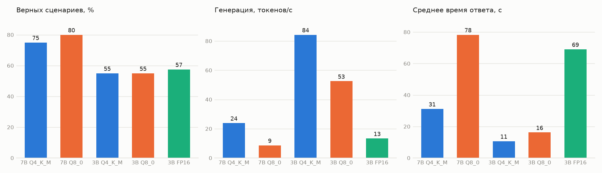

# Сравнение квантизаций

Одна и та же оценка агента (40 сценариев, ReAct, temperature 0), ноутбук: RTX 4050 6 ГБ, 16 ГБ ОЗУ. Скорость — генерация 256 токенов на одинаковом запросе после прогрева. 7B в FP16 (15,2 ГБ) на этом ноутбуке не помещается.

| Модель | Квантизация | Размер | В видеопамяти | Генерация, ток/с | Верно (из 40) | Отложенные H | Нормы | Precision / Recall | Время ответа |
|---|---|---|---|---|---|---|---|---|---|
| 7B | Q4_K_M | 5,4 ГБ | 76 % | 24 | **30** | 9/12 | 3/10 | 1,00 / 0,87 | 31 с |
| 7B | Q8_0 | 8,8 ГБ | 48 % | 9 | **32** | 10/12 | 4/10 | 1,00 / 0,94 | 78 с |
| 3B | Q4_K_M | 2,4 ГБ | 100 % | 84 | **22** | 5/12 | 2/10 | 1,00 / 0,65 | 11 с |
| 3B | Q8_0 | 3,7 ГБ | 100 % | 53 | **22** | 7/12 | 1/10 | 1,00 / 0,58 | 16 с |
| 3B | FP16 | 7,2 ГБ | 57 % | 13 | **23** | 6/12 | 1/10 | 1,00 / 0,74 | 69 с |

