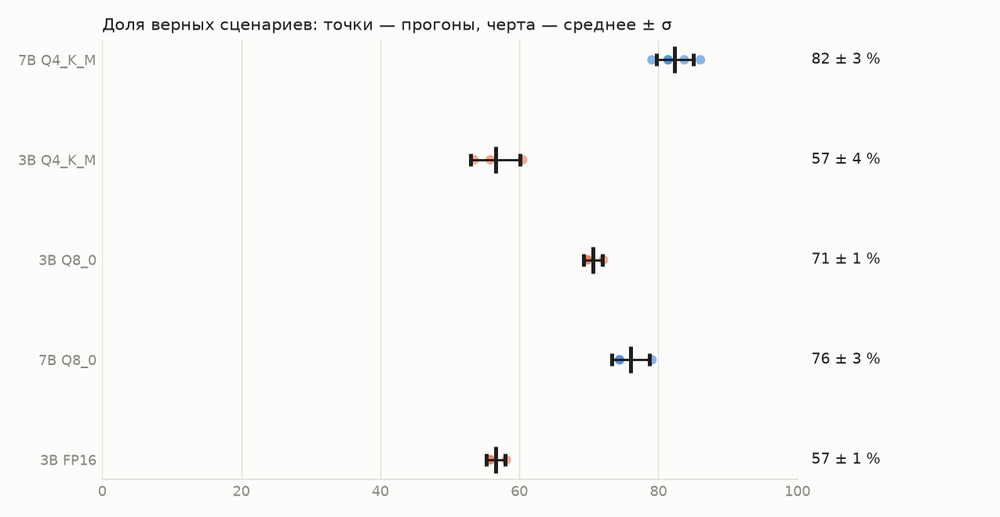

# Повторные прогоны оценки

Партия `repeats-2026-11-02`, коммит(ы): 251612d. 43 сценариев, ReAct, temperature 0. Среднее ± стандартное отклонение по прогонам.

| Конфигурация | Прогонов | Верно (среднее ± σ) | Минимум–максимум | Время ответа |
|---|---|---|---|---|
| 7B Q4_K_M | 5 | **35,4 ± 1,1** из 43 | 34–37 | 32 с |
| 3B Q4_K_M | 3 | **24,3 ± 1,5** из 43 | 23–26 | 15 с |
| 3B Q8_0 | 3 | **30,3 ± 0,6** из 43 | 30–31 | 31 с |
| 7B Q8_0 | 3 | **32,7 ± 1,2** из 43 | 32–34 | 94 с |
| 3B FP16 | 3 | **24,3 ± 0,6** из 43 | 24–25 | 141 с |

## По группам (среднее ± σ)

| Группа | 7B Q4_K_M | 3B Q4_K_M | 3B Q8_0 | 7B Q8_0 | 3B FP16 |
|---|---|---|---|---|---|
| Диагностика | 12,0 ± 0,0 / 13 | 6,7 ± 0,6 / 13 | 7,0 ± 0,0 / 13 | 11,0 ± 0,0 / 13 | 7,0 ± 0,0 / 13 |
| Проблем нет | 3,0 ± 0,0 / 3 | 3,0 ± 0,0 / 3 | 3,0 ± 0,0 / 3 | 2,0 ± 0,0 / 3 | 3,0 ± 0,0 / 3 |
| Нетипичные | 4,2 ± 0,4 / 6 | 4,0 ± 1,0 / 6 | 4,3 ± 0,6 / 6 | 4,0 ± 0,0 / 6 | 4,0 ± 0,0 / 6 |
| Отложенные | 10,8 ± 0,4 / 12 | 6,7 ± 0,6 / 12 | 9,3 ± 0,6 / 12 | 10,0 ± 0,0 / 12 | 7,3 ± 0,6 / 12 |
| Нормы | 2,8 ± 0,4 / 6 | 1,0 ± 0,0 / 6 | 3,7 ± 0,6 / 6 | 3,0 ± 1,0 / 6 | 1,7 ± 0,6 / 6 |
| Сравнение периодов | 2,6 ± 0,5 / 3 | 3,0 ± 0,0 / 3 | 3,0 ± 0,0 / 3 | 2,7 ± 0,6 / 3 | 1,3 ± 0,6 / 3 |

## 7B Q4_K_M: нестабильные сценарии (проходят не во всех 5 прогонах)

| ID | Вопрос | Доля прогонов, где верно |
|---|---|---|
| A05 | проверь итп3 за всю зиму | 20 % |
| R04 | Сколько горячей воды может не быть подряд при плановом ремонте? | 20 % |
| C01 | Сравни январь и февраль на ИТП-3 | 60 % |
| R03 | Допустимо ли, что среднесуточная обратка на 4% выше графика? | 60 % |
| H10 | Сколько часов может не быть отопления? | 80 % |

## 7B Q4_K_M: не проходят ни в одном прогоне

| ID | Вопрос |
|---|---|
| A03 | Сравни ИТП-1 и ИТП-4: у кого хуже с датчиками в феврале? |
| H05 | Проверь ИТП-5 с декабря по февраль |
| R01 | Какой допуск по температуре подачи относительно графика? |
| R06 | Что по правилам должно быть сделано в тепловом пункте перед отопительным сезоном? |
| S10 | Как работал ИТП-1 в январе? |

