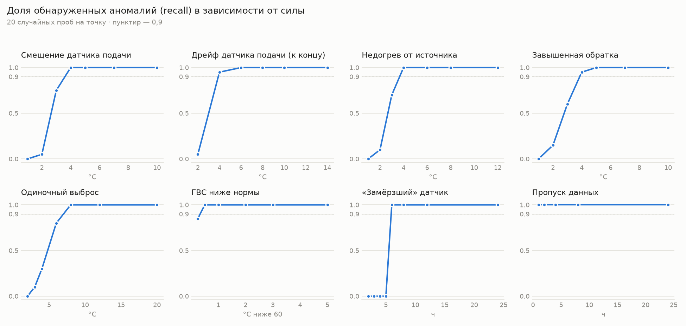

# Чувствительность детекторов

20 случайных проб на каждый уровень силы: новый синтетический ряд (погода и шум), случайное место и длительность аномалии. Попадание — событие нужного типа по нужному параметру с пересечением по времени ±6 ч. Запуск: `python -m eval.eval_sensitivity`.

| Аномалия | Порог | Обнаруживается с (recall ≥ 0,9) | Recall по уровням |
|---|---|---|---|
| Смещение датчика подачи | ±3 % от графика ≈ 2,5–3 °C | 4 °C | 1: 0,00 · 2: 0,05 · 3: 0,75 · 4: 1,00 · 5: 1,00 · 7: 1,00 · 10: 1,00 (°C) |
| Дрейф датчика подачи (к концу) | ±3 % от графика | 4 °C | 2: 0,05 · 4: 0,95 · 6: 1,00 · 8: 1,00 · 10: 1,00 · 14: 1,00 (°C) |
| Недогрев от источника | ±3 % от графика | 4 °C | 1: 0,00 · 2: 0,10 · 3: 0,70 · 4: 1,00 · 6: 1,00 · 8: 1,00 · 12: 1,00 (°C) |
| Завышенная обратка | +5 % от графика ≈ 2,5–3 °C | 4 °C | 1: 0,00 · 2: 0,15 · 3: 0,60 · 4: 0,95 · 5: 1,00 · 7: 1,00 · 10: 1,00 (°C) |
| Одиночный выброс | k·σ соседних разностей, не менее 2,5 °C | 8 °C | 2: 0,00 · 3: 0,10 · 4: 0,30 · 6: 0,80 · 8: 1,00 · 12: 1,00 · 20: 1,00 (°C) |
| ГВС ниже нормы | 60 °C | 0,5 °C ниже 60 | 0,25: 0,85 · 0,5: 1,00 · 1: 1,00 · 2: 1,00 · 3: 1,00 · 5: 1,00 (°C ниже 60) |
| «Замёрзший» датчик | порог детектора 6 ч | 6 ч | 2: 0,00 · 3: 0,00 · 4: 0,00 · 5: 0,00 · 6: 1,00 · 8: 1,00 · 12: 1,00 · 24: 1,00 (ч) |
| Пропуск данных | любой пропуск | 1 ч | 1: 1,00 · 2: 1,00 · 4: 1,00 · 8: 1,00 · 24: 1,00 (ч) |

**Ложные срабатывания.** На 30 чистых рядах (42480 ч): 0 события на 1000 ч. Посторонние события в пробах с аномалиями: 0,002 на 1000 ч.

## Подбор порога выбросов

Выброс — точка, отличающаяся и от предыдущего, и от следующего часа больше чем на max(k · σ, нижняя граница), где σ — робастная оценка разброса часовых разностей (MAD · 1,4826). Текущий выбор: k = 4, граница 2,5 °C.

| k | Нижняя граница, °C | Recall при 3 °C | Recall при 4 °C | Recall при 6 °C | Recall при 8 °C | Recall при 12 °C | Ложных выбросов на чистых рядах |
|---|---|---|---|---|---|---|---|
| 8 | 4 | 0,00 | 0,00 | 0,00 | 0,40 | 1,00 | 0 (0,00 на 1000 ч) |
| 6 | 3 | 0,00 | 0,00 | 0,55 | 0,55 | 1,00 | 0 (0,00 на 1000 ч) |
| 5 | 3 | 0,00 | 0,10 | 0,60 | 0,75 | 1,00 | 0 (0,00 на 1000 ч) |
| 4 | 2,5 | 0,10 | 0,30 | 0,80 | 1,00 | 1,00 | 0 (0,00 на 1000 ч) |
| 3 | 2 | 0,50 | 0,65 | 0,95 | 1,00 | 1,00 | 5 (0,12 на 1000 ч) |
